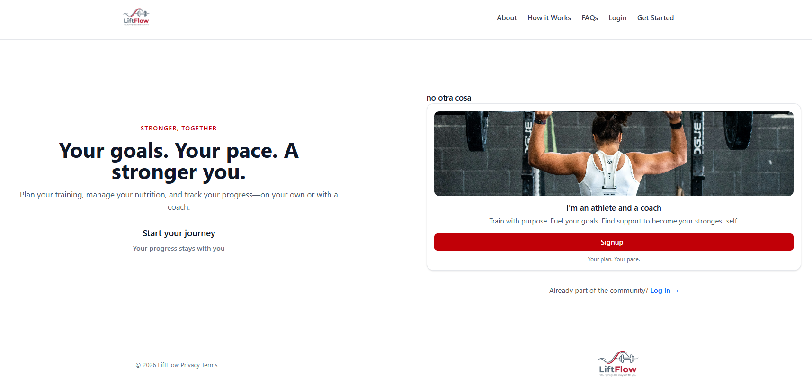

# LiftFlow 🏋️
 
**Stronger, together.** LiftFlow is a full-stack fitness platform where athletes and coaches can plan training, manage nutrition, and track progress, on your own or with a coach.

Users create an account as an **athlete**, a **coach**, or **both**, and the experience adapts to the role they choose.



## Demo
🔗 [Live Demo]()

## Features
**Available**
- Landing page where users choose how they will use LiftFlow (athlete or coach)
- Account creation with name, role (athlete, coach, or both), email, and password
- Server-side validation: valid email, password of at least 8 characters, matching password confirmation, and unique email and username
- Secure authentication with Passport (local strategy), hashed passwords with bcrypt, and sessions stored in MongoDB
- Flash messages for errors such as duplicate accounts or wrong credentials
- Role saved in the database and validated on the server so only allowed values are stored
- Posts with image upload and a feed
- Dashboard layout with a sidebar: Dashboard, Workouts, Plans, Progress, Exercises, Nutrition, and Coaching Hub
**In progress**
- Different dashboards depending on the user's role (athlete, coach, or both)
- Onboarding steps: Account and Profile, Discipline and Experience, Goals, Availability and Environment, Starting Point, and Nutrition
- Fully responsive layout, with a sidebar that collapses on mobile

## Technologies Used
**Front end**
- EJS templates with partials (header and footer)
- Tailwind CSS and custom CSS
- Font Awesome icons
**Back end**
- Node.js and Express
- MongoDB Atlas with Mongoose
- Passport (local strategy), bcrypt, express-session, connect-mongo
- validator, connect-flash, morgan
- Multer and Cloudinary for image uploads (inherited from the base project)

## Getting Started
 
### Prerequisites
- Node.js
- A MongoDB Atlas cluster
- A Cloudinary account (for image uploads)

### Installation
```bash
# Clone the repository
git clone https://github.com/YOUR_USERNAME/LiftFlowv2.git
 
# Go to the project folder
cd LiftFlowv2
 
# Install dependencies
npm install
```
 
### Environment variables
Create a `.env` file in the root of the project (never commit it):
```
PORT=2121
DB_STRING=your_mongodb_connection_string
CLOUD_NAME=your_cloudinary_cloud_name
API_KEY=your_cloudinary_api_key
API_SECRET=your_cloudinary_api_secret
```
 
### Run the app
```bash
node server.js
```
 
Then open `http://localhost:2121` in your browser.
## User Roles
| Role | Description |
| --- | --- |
| `athlete` | Plans workouts, manages nutrition, and tracks progress |
| `coach` | Guides athletes, builds plans, and manages their practice |
| `both` | Has access to both athlete and coach features |
 
## What I Learned
- Building a full-stack app with Express, EJS, and MongoDB, following the MVC pattern
- Implementing authentication with Passport and protecting passwords with bcrypt
- Saving a form field (the role) in the database and validating it on the server instead of trusting the browser
- Troubleshooting a MongoDB Atlas connection issue (DNS SRV lookup error) by using the standard connection string
- Serving static files correctly with Express (`express.static`) and fixing 404 errors on CSS and images
- Building a responsive sidebar layout with Tailwind CSS
- Managing Git remotes, resolving rejected pushes, and merging changes from the remote repository
